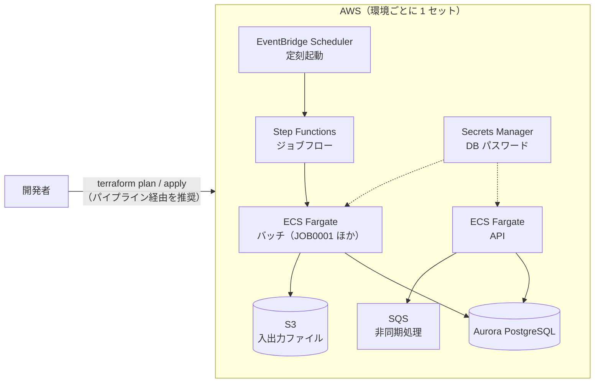

# クラウド開発環境（AWS + Terraform）

ローカルで単体テストまで済んだものを、**クラウドの共有開発環境で結合テスト・疎通確認** するための構成です。
環境は Terraform（IaC）で管理し、手作業でコンソールから作らないことを原則にします。

> ここにあるのは一般的な構成の雛形です。実案件では、アカウント・ネットワーク・命名などをチームの設計に合わせて
> 変更してください。値（アカウント ID・バケット名など）は `*.tfvars` / `backend.hcl` に書き、コミットしません。

> [!WARNING]
> **本番用ではありません・apply すると費用がかかります**
>
> - この構成は **学習と試作のための雛形で、本番用ではありません**。CI では `terraform fmt`・`validate`・tflint・trivy config までしか確かめておらず、
>   実際の AWS アカウントへの `plan` / `apply` は試していません。ALB・WAF・監視・バックアップ設計なども含みません
> - **API を外から呼ぶ入口（ALB など）と、イメージのビルド・ECR への push は作りません**（下の「このサンプルの範囲外」）
> - `terraform apply` すると、作ったものが **起動しているだけで月額の費用がかかります**（下の「費用の目安について」）。使い終わったら `terraform destroy` してください

## 構成



| 区分 | サービス | 用途 | モジュール |
|---|---|---|---|
| 実行基盤 | ECS Fargate | API の常駐とバッチの実行 | `modules/ecs-service` |
| ジョブ制御 | EventBridge Scheduler + Step Functions | 定刻起動とジョブフロー | `modules/batch-workflow` |
| DB | Aurora PostgreSQL | 業務データ（ローカルの PostgreSQL 16 と同じメジャー版） | `modules/aurora-postgres` |
| ストレージ | S3 | 入出力ファイル | `modules/s3-bucket` |
| 非同期 | SQS（デッドレターキュー付き） | 非同期処理 | `modules/sqs-queue` |
| ネットワーク | VPC・サブネット・NAT・VPC エンドポイント | アプリは private サブネット | `modules/network` |
| 秘密情報 | Secrets Manager | DB のパスワード（自動管理。コードに書かない） | 各モジュール |
| 監視・ログ | CloudWatch Logs / Container Insights | ログとメトリクス | 各モジュール |

ALB・WAF・ドメイン・監査系（CloudTrail / GuardDuty / Config）はアカウント共通の基盤として別管理する想定で、ここには含めていません。

### このサンプルの範囲外（作らないもの）

次の 2 つは、このサンプルの Terraform・CI では **作りません**。使うときは、チームの基盤・パイプラインで用意してください。

| 範囲外 | 今の状態 | 用意するときの例 |
|---|---|---|
| **API を外から呼ぶ入口（ALB など）** | API のタスクは private サブネットにあり、セキュリティグループに受信の許可（ingress）がありません。**VPC の外からも、VPC の中の別のリソースからも API には届きません** | ALB（またはアカウント共通の入口）を作り、ターゲットグループに API のサービスを登録し、API のセキュリティグループに ALB からの 8080 を許可する |
| **コンテナイメージのビルドと ECR への push** | ECR のリポジトリも、イメージをビルドして push するパイプラインもありません。`app_image` には、利用者が別に用意したイメージの URI を指定します | ECR のリポジトリを作り、CI（GitHub Actions など）で `bootJar` → `docker build` → `docker push` し、そのタグを `app_image` に渡す |

そのため、下の「構築の流れ」の 5・6 は、上の 2 つを用意した場合の手順です。バッチ（JOB0001）は入口が要らないので、イメージがあれば Step Functions から動かせます。

## バッチのジョブフロー（終了コードの扱い）

`modules/batch-workflow` の Step Functions は、ECS タスクの終了を待ち、バッチの終了コードで結果を分けます
（定義は [modules/batch-workflow/state_machine.tf](modules/batch-workflow/state_machine.tf)）。

| 終了コード | 意味（sample-app） | Step Functions の結果 | 通知（`job0001_notification = true` のとき） |
|---|---|---|---|
| 0 | 正常 | 成功（`Succeeded`） | しない |
| 4 | 警告あり（形式エラーの行を飛ばして取込を続けた） | **成功扱い**（`SucceededWithWarning`） | する（件名に `WARNING`） |
| 8・その他の 0 以外 | 異常終了 | 失敗（`JobFailed`） | する（件名に `FAILED`） |
| 取れない | コンテナが起動しなかった・ECS の起動失敗・時間の上限を超えた | 失敗（`JobFailed`） | する |

- 通知は SNS トピックに発行します。トピックは `job0001_notification = true` のときだけ作り（既定は作らない）、ARN を出力 `job0001_notification_topic_arn` に出します。
  **購読（メール・Chatbot など）はトピックに別に付けてください**（メールアドレスをコードに書かないため）
- 通知に失敗しても、ジョブの結果（成功・失敗）は変えません
- 時間の上限: ジョブ 1 回の実行は `job_timeout_seconds`（モジュールの変数。既定 3600 秒）まで。超えたら ECS タスクを止めて失敗にし、失敗の通知を出します。
  ジョブフロー全体にも上限（`TimeoutSeconds`。ジョブの上限 + 起動の再試行・通知の分 + 余裕）を付けています。長いジョブは環境の `main.tf` で `job_timeout_seconds` を渡します
- 警告で止めたい（4 も失敗にしたい）など運用の決まりが違うときは、`state_machine.tf` の `CheckExitCode` を直します
- CI は、定義を `terraform console` で取り出し、終了コードごとの行き先をテストで確かめます（[.github/scripts/test_batch_workflow.py](../.github/scripts/test_batch_workflow.py)。AWS にはつながない）

## ディレクトリ

```text
cloud/
├── modules/              # 再利用する部品（どの環境でも同じ）
├── environments/
│   ├── dev1/             # 開発環境 #1（複数チームなら dev2, dev3 … を追加）
│   ├── stg/              # 検証環境
│   └── prod/             # 本番環境
└── simple/               # 1 台で手早く試す小さな環境（EC2 + RDS + Nginx）
```

環境の違いは各環境の `main.tf` 冒頭の `locals`（NAT の有無・DB 台数・データ保護・API の台数・VPC エンドポイントの有無）と `terraform.tfvars` だけにし、
構造は全環境で同じにします。

| 環境 | NAT | VPC エンドポイント | DB 台数 | 削除保護 | API 台数 |
|---|---|---|---|---|---|
| dev1 | なし（費用削減） | あり（NAT の代わり） | 1 | なし | 1 |
| stg | あり | なし | 1 | あり | 1 |
| prod | あり | なし | 2 | あり | 2 |

### dev1 の VPC エンドポイント

dev1 は NAT ゲートウェイを置かないので、private サブネットの ECS タスクはインターネットに出られません。
そのままではイメージの取得（ECR）やパスワードの読み出し（Secrets Manager）ができず、タスクが起動しないため、
次の VPC エンドポイントを作ります（`modules/network/endpoints.tf`。`enable_vpc_endpoints = true` のとき）。

| エンドポイント | 種類 | 何に使うか |
|---|---|---|
| `ecr.api`・`ecr.dkr` | インターフェース | コンテナイメージの情報と本体の取得 |
| `s3` | ゲートウェイ（無料） | ECR のイメージの層の取得、アプリの入出力ファイル |
| `secretsmanager` | インターフェース | タスク定義の secrets（DB のパスワード）の読み出し |
| `logs` | インターフェース | CloudWatch Logs へのログ出力 |
| `sqs` | インターフェース | 非同期処理のキュー（アプリが使う場合） |

Step Functions と EventBridge Scheduler は AWS 側から ECS を呼ぶので、タスクからの経路（エンドポイント）は要りません。
アプリがほかの AWS サービスを呼ぶようにしたら、`interface_endpoint_services` に足してください。
インターネット上の外部 API を呼ぶ必要がある場合は、VPC エンドポイントでは届かないので NAT ゲートウェイを使います（`enable_nat_gateway = true`）。

## 構築の流れ

1. 状態ファイル用の S3 バケットとロック用 DynamoDB テーブルを、管理者が 1 回だけ用意する
2. 環境のディレクトリで設定ファイルを作る

   ```bash
   cd environments/dev1
   cp backend.hcl.example backend.hcl
   cp terraform.tfvars.example terraform.tfvars     # 値を埋める
   terraform init -backend-config=backend.hcl
   ```

   provider の版とハッシュは各環境の `.terraform.lock.hcl`（コミット済み）で固定しています。`init` はこのファイルどおりの版を取得します。

3. 差分を確認してレビューを受ける: `terraform plan -out=plan.out`
4. 承認後に反映: `terraform apply plan.out`（本番はパイプライン経由のみ）
5. アプリのイメージを更新したら、`app_image` を新しいタグにして 3〜4 を繰り返す（イメージのビルドと ECR への push は、このサンプルの範囲外。上の「このサンプルの範囲外」）
6. 疎通確認:
   - バッチ: Step Functions の実行（`job0001_state_machine_arn`）を開始し、結果（`Succeeded` / `SucceededWithWarning` / `JobFailed`）と CloudWatch Logs を見る（上の「バッチのジョブフロー」）
   - API: このサンプルには外からの入口（ALB など）が無いので、そのままでは呼べません。入口を用意したら、Karate を `-Dkarate.env=dev -DbaseUrl=<入口の URL>` で実行します

## ローカル環境との対応

| 項目 | ローカル | クラウド |
|---|---|---|
| 実行 | `./gradlew bootRun` | ECS Fargate（コンテナ） |
| DB | PostgreSQL 16（コンテナ） | Aurora PostgreSQL |
| ファイル | S3 エミュレータ（コンテナ） | S3 |
| 非同期 | （必要ならエミュレータを追加） | SQS |
| ジョブ起動 | 起動引数で直接 | EventBridge Scheduler → Step Functions |
| 秘密情報 | `.env`（コミットしない） | Secrets Manager |
| 構築 | `docker compose up` | Terraform |
| 設定の切替 | プロファイル `local` | プロファイル `cloud`（環境変数で値を渡す） |

## 簡易環境（simple/）

試作や短期の検証で、1 台の EC2 にアプリを置いて手早く動かしたいときに使います（Amazon Linux 2023・Corretto 21・Nginx・RDS PostgreSQL）。
EC2 へは SSH ではなく Session Manager で入ります。使い終わったら `terraform destroy` で消してください。

```bash
cd simple
cp terraform.tfvars.example terraform.tfvars    # 接続を許可する IP を書く
terraform init
terraform apply
# jar を置いて起動（Session Manager で接続後）: /opt/app/app.jar と /opt/app/app.env を置き、sudo systemctl start app
```

## 費用の目安について

NAT ゲートウェイ・VPC エンドポイント（インターフェース型）・Aurora・Fargate は、起動しているだけで費用がかかります。
dev 環境は夜間・休日に API を 0 台にする、不要な環境は `terraform destroy` する、などで抑えてください。

dev1 の VPC エンドポイントの目安（東京リージョン、1 か月 = 730 時間で概算。データ処理の従量分は別）:

| 項目 | 計算 | 月額の目安 |
|---|---|---|
| インターフェース型 5 つ（ecr.api・ecr.dkr・secretsmanager・logs・sqs） | 5 つ × 2 AZ × 約 0.014 USD/時間 × 730 時間 | 約 100 USD |
| ゲートウェイ型（s3） | 無料 | 0 USD |
| データ処理（インターフェース型を通る量） | 約 0.01 USD/GB | 使った分 |

比べると、NAT ゲートウェイは 1 つで約 0.062 USD/時間（月 約 45 USD）+ データ処理 約 0.062 USD/GB です。
SQS を使わないなら `interface_endpoint_services` から外すと、月 約 20 USD 減ります。
この表は 2026 年時点の公開料金をもとにした **目安** で、Aurora・Fargate・CloudWatch Logs などの費用は含みません。
最新の料金は AWS の料金ページ（VPC の料金・PrivateLink の料金）で確認してください。

## CI での確認（apply はしない）

[../.github/workflows/ci.yml](../.github/workflows/ci.yml) の `terraform` ジョブが、`cloud/environments/*` と `cloud/simple` で次を実行します。

| 確認 | 内容 |
|---|---|
| `terraform fmt -check -recursive` | 書式 |
| `terraform init -backend=false -lockfile=readonly` → `terraform validate` | 構文と参照（`.terraform.lock.hcl` どおりの provider で） |
| tflint | 書き方の誤り・非推奨の書き方 |
| trivy config | IaC のセキュリティ検査（HIGH 以上）。受け入れた指摘は [.trivyignore](.trivyignore) に理由付きで書く |
| batch-workflow の定義 | `terraform console` で状態機械の定義を取り出し、終了コード 0・4・8 などの行き先、時間の上限（時間切れは失敗）と通知の有無をテストする（[dump_batch_workflow.sh](../.github/scripts/dump_batch_workflow.sh)・[test_batch_workflow.py](../.github/scripts/test_batch_workflow.py)） |
| cloud/simple の入力検査 | `allowed_http_cidrs` に `0.0.0.0/0`・`::/0`・CIDR でない値を渡すと誤りになることを `terraform console` で確かめる（[test_simple_variables.py](../.github/scripts/test_simple_variables.py)） |

### `.terraform.lock.hcl` を作り直すとき

provider の版を上げたとき（`versions.tf` を変えたとき）は、各環境で次を実行してロックファイルを更新し、コミットします。
Windows・Mac・Linux のどれで `init` しても同じハッシュで照合できるよう、プラットフォームを並べます。

```bash
terraform -chdir=environments/dev1 init -backend=false -upgrade
terraform -chdir=environments/dev1 providers lock -platform=linux_amd64 -platform=windows_amd64 -platform=darwin_amd64 -platform=darwin_arm64
```

Dependabot（`.github/dependabot.yml`）は各環境と `simple` の provider の更新を PR で提案し、ロックファイルも更新します。
