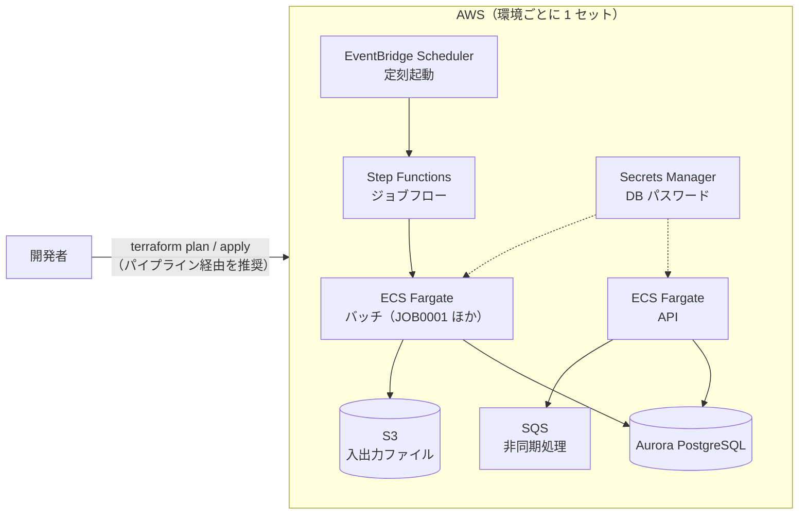

# クラウド開発環境（AWS + Terraform）

ローカルで単体テストまで済んだものを、**クラウドの共有開発環境で結合テスト・疎通確認** するための構成です。
環境は Terraform（IaC）で管理し、手作業でコンソールから作らないことを原則にします。

> ここにあるのは一般的な構成の雛形です。実案件では、アカウント・ネットワーク・命名などをチームの設計に合わせて
> 変更してください。値（アカウント ID・バケット名など）は `*.tfvars` / `backend.hcl` に書き、コミットしません。

## 構成



| 区分 | サービス | 用途 | モジュール |
|---|---|---|---|
| 実行基盤 | ECS Fargate | API の常駐とバッチの実行 | `modules/ecs-service` |
| ジョブ制御 | EventBridge Scheduler + Step Functions | 定刻起動とジョブフロー | `modules/batch-workflow` |
| DB | Aurora PostgreSQL | 業務データ（ローカルの PostgreSQL 16 と同じメジャー版） | `modules/aurora-postgres` |
| ストレージ | S3 | 入出力ファイル | `modules/s3-bucket` |
| 非同期 | SQS（デッドレターキュー付き） | 非同期処理 | `modules/sqs-queue` |
| ネットワーク | VPC・サブネット・NAT | アプリは private サブネット | `modules/network` |
| 秘密情報 | Secrets Manager | DB のパスワード（自動管理。コードに書かない） | 各モジュール |
| 監視・ログ | CloudWatch Logs / Container Insights | ログとメトリクス | 各モジュール |

ALB・WAF・ドメイン・監査系（CloudTrail / GuardDuty / Config）はアカウント共通の基盤として別管理する想定で、ここには含めていません。

## ディレクトリ

```text
cloud/
├── modules/              # 再利用する部品（どの環境でも同じ）
├── environments/
│   ├── dev1/             # 開発環境 #1（複数チームなら dev2, dev3 … を追加）
│   ├── stg/              # 検証環境
│   └── prod/             # 本番環境
└── simple/               # 1 台で手早く試す小さな環境（EC2 + RDS + Nginx）
```

環境の違いは各環境の `main.tf` 冒頭の `locals`（NAT の有無・DB 台数・データ保護・API の台数）と `terraform.tfvars` だけにし、
構造は全環境で同じにします。

| 環境 | NAT | DB 台数 | 削除保護 | API 台数 |
|---|---|---|---|---|
| dev1 | なし（費用削減。外部アクセスが必要なら VPC エンドポイントを追加） | 1 | なし | 1 |
| stg | あり | 1 | あり | 1 |
| prod | あり | 2 | あり | 2 |

## 構築の流れ

1. 状態ファイル用の S3 バケットとロック用 DynamoDB テーブルを、管理者が 1 回だけ用意する
2. 環境のディレクトリで設定ファイルを作る

   ```bash
   cd environments/dev1
   cp backend.hcl.example backend.hcl
   cp terraform.tfvars.example terraform.tfvars     # 値を埋める
   terraform init -backend-config=backend.hcl
   ```

3. 差分を確認してレビューを受ける: `terraform plan -out=plan.out`
4. 承認後に反映: `terraform apply plan.out`（本番はパイプライン経由のみ）
5. アプリのイメージを ECR に push し、`app_image` を更新して 3〜4 を繰り返す
6. 疎通確認: API は Karate を `-Dkarate.env=dev -DbaseUrl=<URL>` で実行、バッチは Step Functions の実行結果を見る

## ローカル環境との対応

| 項目 | ローカル | クラウド |
|---|---|---|
| 実行 | `./gradlew bootRun` | ECS Fargate（コンテナ） |
| DB | PostgreSQL 16（コンテナ） | Aurora PostgreSQL |
| ファイル | S3 エミュレータ（コンテナ） | S3 |
| 非同期 | （必要ならエミュレータを追加） | SQS |
| ジョブ起動 | 起動引数で直接 | EventBridge Scheduler → Step Functions |
| 秘密情報 | `.env`（コミットしない） | Secrets Manager |
| 構築 | `docker compose up` | Terraform |
| 設定の切替 | プロファイル `local` | プロファイル `cloud`（環境変数で値を渡す） |

## 簡易環境（simple/）

試作や短期の検証で、1 台の EC2 にアプリを置いて手早く動かしたいときに使います（Amazon Linux 2023・Corretto 21・Nginx・RDS PostgreSQL）。
EC2 へは SSH ではなく Session Manager で入ります。使い終わったら `terraform destroy` で消してください。

```bash
cd simple
cp terraform.tfvars.example terraform.tfvars    # 接続を許可する IP を書く
terraform init && terraform apply
# jar を置いて起動（Session Manager で接続後）: /opt/app/app.jar と /opt/app/app.env を置き、sudo systemctl start app
```

## 費用の目安について

NAT ゲートウェイ・Aurora・Fargate は起動しているだけで費用がかかります。dev 環境は夜間・休日に API を 0 台にする、
不要な環境は `terraform destroy` する、などで抑えてください。最新の料金は AWS の料金ページで確認してください。
