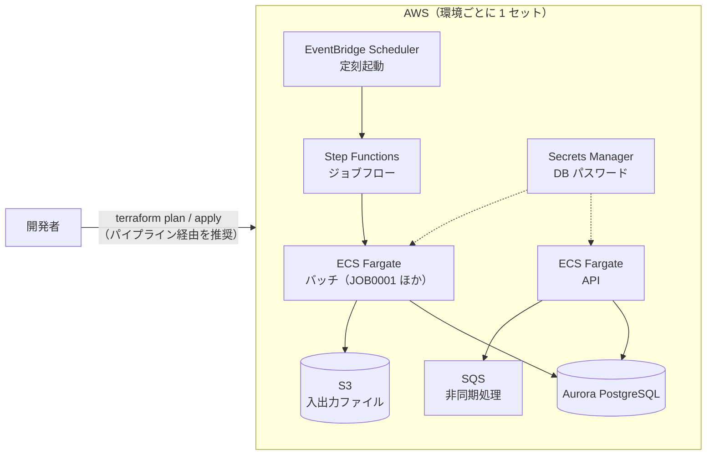

# クラウド開発環境（AWS + Terraform）

ローカルで単体テストまで済んだものを、**クラウドの共有開発環境で結合テスト・疎通確認** するための構成です。
環境は Terraform（IaC）で管理し、手作業でコンソールから作らないことを原則にします。

> ここにあるのは一般的な構成の雛形です。実案件では、アカウント・ネットワーク・命名などをチームの設計に合わせて
> 変更してください。値（アカウント ID・バケット名など）は `*.tfvars` / `backend.hcl` に書き、コミットしません。

> [!WARNING]
> **本番用ではありません・apply すると費用がかかります**
>
> - この構成は **学習と試作のための雛形で、本番用ではありません**。CI では `terraform fmt`・`validate`・tflint・trivy config までしか確かめておらず、
>   実際の AWS アカウントへの `plan` / `apply` は試していません。ALB・WAF・監視・バックアップ設計なども含みません
> - **API を外から呼ぶ入口（ALB など）と、イメージのビルド・ECR への push は作りません**（下の「このサンプルの範囲外」）
> - `terraform apply` すると、作ったものが **起動しているだけで月額の費用がかかります**（下の「費用の目安について」）。使い終わったら `terraform destroy` してください

## 構成



| 区分 | サービス | 用途 | モジュール |
|---|---|---|---|
| 実行基盤 | ECS Fargate | API の常駐とバッチの実行 | `modules/ecs-service` |
| ジョブ制御 | EventBridge Scheduler + Step Functions | 定刻起動とジョブフロー | `modules/batch-workflow` |
| DB | Aurora PostgreSQL | 業務データ（ローカルの PostgreSQL 16 と同じメジャー版） | `modules/aurora-postgres` |
| ストレージ | S3 | 入出力ファイル | `modules/s3-bucket` |
| 非同期 | SQS（デッドレターキュー付き） | 非同期処理 | `modules/sqs-queue` |
| ネットワーク | VPC・サブネット・NAT・VPC エンドポイント | アプリは private サブネット | `modules/network` |
| 秘密情報 | Secrets Manager | DB のパスワード（自動管理。コードに書かない） | 各モジュール |
| 監視・ログ | CloudWatch Logs / Container Insights | ログとメトリクス | 各モジュール |

ALB・WAF・ドメイン・監査系（CloudTrail / GuardDuty / Config）はアカウント共通の基盤として別管理する想定で、ここには含めていません。

### このサンプルの範囲外（作らないもの）

次の 2 つは、このサンプルの Terraform・CI では **作りません**。使うときは、チームの基盤・パイプラインで用意してください。

| 範囲外 | 今の状態 | 用意するときの例 |
|---|---|---|
| **API を外から呼ぶ入口（ALB など）** | API のタスクは private サブネットにあり、セキュリティグループに受信の許可（ingress）がありません。**VPC の外からも、VPC の中の別のリソースからも API には届きません** | ALB（またはアカウント共通の入口）を作り、ターゲットグループに API のサービスを登録し、API のセキュリティグループに ALB からの 8080 を許可する |
| **コンテナイメージのビルドと ECR への push** | ECR のリポジトリも、イメージをビルドして push するパイプラインもありません。`app_image` には、利用者が別に用意したイメージの URI を指定します | ECR のリポジトリを作り、CI（GitHub Actions など）で `bootJar` → `docker build` → `docker push` し、そのタグを `app_image` に渡す。イメージは **`ENTRYPOINT` を `java -jar` にする**（下の「コンテナイメージの決まり」。例: [sample-app/Dockerfile](../sample-app/Dockerfile)） |

そのため、下の「構築の流れ」の 5・7 は、上の 2 つを用意した場合の手順です。バッチ（JOB0001）は入口が要らないので、イメージがあれば Step Functions から動かせます。

### コンテナイメージの決まり（ENTRYPOINT と Command）

バッチのジョブフロー（`modules/batch-workflow`）は、ECS のコンテナの上書き（`ContainerOverrides` の `Command`）で、
環境の `main.tf` の `command`（例: `["--app.batch.job=JOB0001", "--input=s3://…"]`）を渡します。
ECS の `Command` は Docker の `CMD` を置き換えるので、**イメージは次の形にしてください**。

- `ENTRYPOINT ["java", "-jar", "/opt/app/app.jar"]`（exec 形式）にし、`CMD` は書かない。`Command` が Spring Boot の起動引数として後ろに付きます
- `ENTRYPOINT` を書かずに `CMD ["java", "-jar", …]` にすると、`Command` で起動のコマンドごと置き換わり、`--app.batch.job=JOB0001` を実行しようとしてタスクが起動しません（Step Functions は `JobFailed`）
- API とバッチは同じイメージで、プロファイル（タスク定義の環境変数 `SPRING_PROFILES_ACTIVE`。API は `cloud`、バッチは `cloud,batch`）で切り替えます

例は [sample-app/Dockerfile](../sample-app/Dockerfile) です（`./gradlew bootJar` の後に `docker build`）。CI の `e2e` ジョブが、このイメージを作り、
`--app.batch.job=…` を後ろに付けて起動できること（存在しないジョブ ID で終了コード 8・APPE0006）と、起動そのものの失敗も終了コード 8 になることを確かめます。

## バッチのジョブフロー（終了コードの扱い）

`modules/batch-workflow` の Step Functions は、ECS タスクの終了を待ち、バッチの終了コードで結果を分けます
（定義は [modules/batch-workflow/state_machine.tf](modules/batch-workflow/state_machine.tf)）。

| 終了コード | 意味（sample-app） | Step Functions の結果 | 通知（`job0001_notification = true` のとき） |
|---|---|---|---|
| 0 | 正常 | 成功（`Succeeded`） | しない |
| 4 | 警告あり（形式エラーの行を飛ばして取込を続けた） | **成功扱い**（`SucceededWithWarning`） | する（件名に `WARNING`） |
| 6 | 内容の違う重複あり（登録済みの注文番号で内容が違う行を、取り込まずに飛ばした。人が確かめる） | 失敗（`JobFailed`） | する（件名に `FAILED`） |
| 8・その他の 0 以外 | 異常終了（バッチの起動そのものの失敗も 8） | 失敗（`JobFailed`） | する（件名に `FAILED`） |
| 取れない | コンテナが起動しなかった・ECS の起動失敗・時間の上限を超えた | 失敗（`JobFailed`） | する |

- 通知は SNS トピックに発行します。トピックは `job0001_notification = true` のときだけ作り（既定は作らない）、ARN を出力 `job0001_notification_topic_arn` に出します。
  **購読（メール・Chatbot など）はトピックに別に付けてください**（メールアドレスをコードに書かないため）
- 通知に失敗しても、ジョブの結果（成功・失敗）は変えません
- 時間の上限: ジョブ 1 回の実行は `job_timeout_seconds`（モジュールの変数。既定 3600 秒）まで。超えたら ECS タスクを止めて失敗にし、失敗の通知を出します。
  ジョブフロー全体にも上限（`TimeoutSeconds`。ジョブの上限 + 通知の分 + 余裕）を付けています。長いジョブは環境の `main.tf` で `job_timeout_seconds` を渡します
- 警告で止めたい（4 も失敗にしたい）など運用の決まりが違うときは、`state_machine.tf` の `CheckExitCode` を直します
- CI は、定義を `terraform console` で取り出し、終了コードごとの行き先をテストで確かめます（[.github/scripts/test_batch_workflow.py](../.github/scripts/test_batch_workflow.py)。AWS にはつながない）

### 再試行と多重実行

- **ジョブ（`RunJob`）は自動で再試行しません。** `ecs:runTask.sync` のエラー（`ECS.AmazonECSException` など）は、タスクの起動前の失敗か、
  起動した後（終了を待つ間）の失敗かをエラー名で区別できません。起動後の失敗で再試行すると、同じジョブの ECS タスクが 2 つ動きます（二重起動）。
  失敗は通知（`JobFailed`）で人に知らせ、CloudWatch Logs と実行の入出力で原因を確かめてから、Step Functions の実行を開始し直します
- **多重実行は Step Functions では防いでいません（このサンプルの制約）。** 次のときは、同じジョブが同時に 2 つ動きえます
  - スケジュールの間隔が、ジョブにかかる時間（最長はジョブフロー全体の `TimeoutSeconds`）より短い
  - 定刻の実行中に、手で実行を開始した
  - EventBridge Scheduler の配信は「少なくとも 1 回」で、まれに同じ定刻の起動が重なることがある
- そのため、ジョブ自体を **何回・同時に動いても結果が変わらない** 作りにしています。JOB0001 は注文番号の一意制約と `ON CONFLICT DO NOTHING` で
  二重登録にならず、同じ内容の重複は `duplicated` として飛ばします（内容の違う重複は終了コード 6）。
  スケジュールの間隔はジョブフロー全体の `TimeoutSeconds` より長くしてください（既定の `job_timeout_seconds = 3600` なら 1 時間 + 約 11 分）
- 冪等にできないジョブを足すときは、同時に 1 つだけ動くようにする仕組みが別に要ります（例: ジョブの最初に DynamoDB の条件付き書き込みでロックを取る、
  Step Functions の `ListExecutions` で実行中の数を確かめて 2 つ目は止める）。このサンプルには入れていません

## ディレクトリ

```text
cloud/
├── modules/              # 再利用する部品（どの環境でも同じ）
├── environments/
│   ├── dev1/             # 開発環境 #1（複数チームなら dev2, dev3 … を追加）
│   ├── stg/              # 検証環境
│   └── prod/             # 本番環境
└── simple/               # 1 台で手早く試す小さな環境（EC2 + RDS + Nginx）
```

環境の違いは各環境の `main.tf` 冒頭の `locals`（NAT の有無・DB 台数・データ保護・API の台数・VPC エンドポイントの有無）と `terraform.tfvars` だけにし、
構造は全環境で同じにします。

| 環境 | NAT | VPC エンドポイント | DB 台数 | 削除保護 | API 台数 |
|---|---|---|---|---|---|
| dev1 | なし（費用削減） | あり（NAT の代わり） | 1 | なし | 1 |
| stg | あり | なし | 1 | あり | 1 |
| prod | あり | なし | 2 | あり | 2 |

### dev1 の VPC エンドポイント

dev1 は NAT ゲートウェイを置かないので、private サブネットの ECS タスクはインターネットに出られません。
そのままではイメージの取得（ECR）やパスワードの読み出し（Secrets Manager）ができず、タスクが起動しないため、
次の VPC エンドポイントを作ります（`modules/network/endpoints.tf`。`enable_vpc_endpoints = true` のとき）。

| エンドポイント | 種類 | 何に使うか |
|---|---|---|
| `ecr.api`・`ecr.dkr` | インターフェース | コンテナイメージの情報と本体の取得 |
| `s3` | ゲートウェイ（無料） | ECR のイメージの層の取得、アプリの入出力ファイル |
| `secretsmanager` | インターフェース | タスク定義の secrets（DB のパスワード）の読み出し |
| `logs` | インターフェース | CloudWatch Logs へのログ出力 |
| `sqs` | インターフェース | 非同期処理のキュー（アプリが使う場合） |

Step Functions と EventBridge Scheduler は AWS 側から ECS を呼ぶので、タスクからの経路（エンドポイント）は要りません。
アプリがほかの AWS サービスを呼ぶようにしたら、`interface_endpoint_services` に足してください。
インターネット上の外部 API を呼ぶ必要がある場合は、VPC エンドポイントでは届かないので NAT ゲートウェイを使います（`enable_nat_gateway = true`）。

## 構築の流れ

1. 状態ファイル用の S3 バケットとロック用 DynamoDB テーブルを、管理者が 1 回だけ用意する
2. 環境のディレクトリで設定ファイルを作る

   ```bash
   cd environments/dev1
   cp backend.hcl.example backend.hcl
   cp terraform.tfvars.example terraform.tfvars     # 値を埋める
   terraform init -backend-config=backend.hcl
   ```

   provider の版とハッシュは各環境の `.terraform.lock.hcl`（コミット済み）で固定しています。`init` はこのファイルどおりの版を取得します。

3. 差分を確認してレビューを受ける: `terraform plan -out=plan.out`
4. 承認後に反映: `terraform apply plan.out`（本番はパイプライン経由のみ）
5. アプリのイメージを更新したら、`app_image` を新しいタグにして 3〜4 を繰り返す（イメージのビルドと ECR への push は、このサンプルの範囲外。上の「このサンプルの範囲外」）
6. テーブルを作る（初回だけ。下の「DB にテーブルを作る」）。ローカルの `local/db/init/*.sql` は docker の初回起動のときにしか流れないので、
   Aurora には **テーブルがありません**。作らずに疎通確認をすると、API は 500、バッチは終了コード 8（`relation "orders" does not exist`）になります
7. 疎通確認（6 が済んでいることが前提）:
   - バッチ: Step Functions の実行（`job0001_state_machine_arn`）を開始し、結果（`Succeeded` / `SucceededWithWarning` / `JobFailed`）と CloudWatch Logs を見る（上の「バッチのジョブフロー」）
   - API: このサンプルには外からの入口（ALB など）が無いので、そのままでは呼べません。入口を用意したら、Karate を `-Dkarate.env=dev -DbaseUrl=<入口の URL>` で実行します

### DB にテーブルを作る（スキーマの適用）

Aurora は private サブネットにあり、DB のセキュリティグループは API とバッチのタスクからの 5432 だけを許可しています。
新しいリソース（踏み台の EC2 など）を作らずに、**AWS CloudShell の VPC 環境**（CloudShell は追加料金なし）から `psql` で
[local/db/init/01_schema.sql](../local/db/init/01_schema.sql) を流します。Terraform は使いません（`plan` / `apply` もしません）。

1. 値を確かめる（`terraform output` は state を読むだけで、AWS の設定は変えません）
   - DB のエンドポイント: `terraform output -raw db_endpoint`
   - マスターユーザーのパスワード: RDS のコンソールでクラスターを開き、「設定」の「マスター認証情報の ARN」の Secrets Manager のシークレット（`username`・`password`）
   - バッチのタスクのセキュリティグループ（DB への 5432 が許可されているもの）: ECS のコンソールでバッチのタスク定義・サービスの設定から確かめる
2. CloudShell を開き、「アクション」→「VPC 環境を作成」で、VPC = この環境の VPC、サブネット = private サブネットの 1 つ、
   セキュリティグループ = 1 のバッチのセキュリティグループ を選ぶ
3. `psql --version` で psql があることを確かめ、接続する（パスワードは聞かれたら貼り付ける。コマンドの履歴に残さない）

   ```bash
   psql "host=<db_endpoint> port=5432 dbname=sampledb user=<username> sslmode=require"
   ```

4. `01_schema.sql` の中身を貼り付けて実行し、`\dt` で `member` と `orders` があることを確かめる。
   疎通確認で JOB0001 を動かすなら、取込先の会員が要るので `02_data.sql`（架空の会員 2 件）も流す（入れないと、すべての行が「会員が存在しません」で終了コード 4）
5. 終わったら CloudShell の VPC 環境を削除する

- VPC 環境では CloudShell へのファイルのアップロードができないので、SQL は貼り付けます（数行なので貼り付けで足ります）
- 流し直すと `CREATE TABLE` が「既にある」で失敗します（テーブルはそのまま）。作り直すときは、データが消えてよいことを確かめてから `DROP TABLE orders, member;`
- 実案件では、スキーマの変更は Flyway・Liquibase などのマイグレーションツールで、パイプラインやアプリの起動時に流す形にしてください（このサンプルには入れていません）
- `simple/` の RDS は、Session Manager で EC2 に入り、EC2 に入っている `psql`（`user_data.sh` が入れる）で同じように流します

### アプリ用の DB ユーザー

既定（`app_db_secret_arn` を指定しないとき）は、API とバッチが **Aurora のマスターユーザー** で接続します。マスターユーザーはテーブルの削除や
ユーザーの作成もできるので、学習・試作用の割り切りです。**実案件や、共有の環境では、業務データの読み書きだけができるアプリ用のユーザーを作って切り替えてください。**
Terraform にはユーザーを作る処理を入れていません（DB は private サブネットにあり、Terraform から SQL を流せないため）。手順は次のとおりです。

1. 上の「DB にテーブルを作る」と同じく、CloudShell の VPC 環境からマスターユーザーで `sampledb` に接続する（テーブルを先に作っておく）
2. [db/create_app_user.sql](db/create_app_user.sql) の中身を貼り付けて実行する。パスワードは `\prompt` で聞かれたときに貼り付ける（長いランダムな文字列。`aws secretsmanager get-random-password` などで作る）。
   できるのは `SELECT`・`INSERT`（sample-app が使うもの）と、シーケンスの利用だけです。テーブルの作成・削除はできません
3. 同じユーザー名とパスワードを、JSON の `username`・`password` の形で Secrets Manager に入れる（コンソールの「その他のシークレット」か、次のコマンド。
   パスワードをコマンドの履歴に残さないよう、ファイルから読む）

   ```bash
   aws secretsmanager create-secret --name sample-dev1/db-app-user --secret-string file://app-user.json   # {"username":"sample_app","password":"…"}
   rm app-user.json
   ```

4. 環境の `terraform.tfvars` に、そのシークレットの ARN を `app_db_secret_arn = "arn:aws:secretsmanager:…"` と書き、`plan` → レビュー → `apply` する。
   API・バッチのタスク定義の `DB_USER`・`DB_PASSWORD` がアプリ用のユーザーに変わり、タスクの実行ロールが読めるシークレットもそれだけになります
5. API・バッチを動かして確かめる（権限が足りなければ `permission denied for table …` が出る）

- パスワードを変えるときは、`ALTER ROLE sample_app PASSWORD …` とシークレットの値を両方変え、API のタスクを入れ替えます（シークレットの自動ローテーションはこのサンプルに入れていません）
- スキーマの変更（テーブルの作成・変更）は、マスターユーザーか、マイグレーション用のユーザーで行います

## ローカル環境との対応

| 項目 | ローカル | クラウド |
|---|---|---|
| 実行 | `./gradlew bootRun` | ECS Fargate（コンテナ） |
| DB | PostgreSQL 16（コンテナ） | Aurora PostgreSQL |
| ファイル | S3 エミュレータ（コンテナ） | S3 |
| 非同期 | （必要ならエミュレータを追加） | SQS |
| ジョブ起動 | 起動引数で直接 | EventBridge Scheduler → Step Functions |
| 秘密情報 | `.env`（コミットしない） | Secrets Manager |
| 構築 | `docker compose up` | Terraform |
| 設定の切替 | プロファイル `local` | プロファイル `cloud`（環境変数で値を渡す） |

## 簡易環境（simple/）

試作や短期の検証で、1 台の EC2 にアプリを置いて手早く動かしたいときに使います（Amazon Linux 2023・Corretto 21・Nginx・RDS PostgreSQL）。
EC2 へは SSH ではなく Session Manager で入ります。使い終わったら `terraform destroy` で消してください。

```bash
cd simple
cp terraform.tfvars.example terraform.tfvars    # 接続を許可する IP を書く
terraform init
terraform apply
# jar を置いて起動（Session Manager で接続後）: /opt/app/app.jar と /opt/app/app.env を置き、sudo systemctl start app
```

#### `/opt/app/app.env`（アプリの設定）

`app.service`（`user_data.sh` が作る）は `/opt/app/app.env` を環境変数として読みます。次の値を書きます（`KEY=値` を 1 行ずつ。引用符は付けない）。

| 変数 | 値 | どこから |
|---|---|---|
| `SPRING_PROFILES_ACTIVE` | `cloud` | 固定（API として起動する） |
| `DB_URL` | `jdbc:postgresql://<db_endpoint>:5432/sampledb` | `terraform output -raw db_endpoint` |
| `DB_USER` | マスターユーザー名（既定 `app_admin`）か、アプリ用のユーザー | シークレットの `username` |
| `DB_PASSWORD` | パスワード | シークレットの `password`（`terraform output -raw db_master_user_secret_arn` のシークレット） |

EC2 のロールには、RDS が管理するマスターユーザーのシークレットだけを読む権限（`secretsmanager:GetSecretValue`）を付けています。
Session Manager で入った後、EC2 の上で次のように作ると、パスワードを手で写さずに済みます（AWS CLI は Amazon Linux 2023 に入っています）。

```bash
SECRET_ARN=<terraform output -raw db_master_user_secret_arn の値>
DB_ENDPOINT=<terraform output -raw db_endpoint の値>
secret=$(aws secretsmanager get-secret-value --secret-id "$SECRET_ARN" --query SecretString --output text)
sudo install -o app -g app -m 600 /dev/null /opt/app/app.env
{
  echo "SPRING_PROFILES_ACTIVE=cloud"
  echo "DB_URL=jdbc:postgresql://${DB_ENDPOINT}:5432/sampledb"
  echo "DB_USER=$(echo "$secret" | python3 -c 'import json,sys; print(json.load(sys.stdin)["username"])')"
  echo "DB_PASSWORD=$(echo "$secret" | python3 -c 'import json,sys; print(json.load(sys.stdin)["password"])')"
} | sudo tee /opt/app/app.env > /dev/null
unset secret
sudo systemctl restart app
```

- `app.env` はパスワードを含むので、所有者 `app`・権限 `600` にします（上の `install`）。RDS がパスワードを自動で変えた（ローテーション）ときは、作り直して `systemctl restart app` します
- テーブルは上の「DB にテーブルを作る」の最後の項目（EC2 の `psql`）で作ります。アプリ用のユーザーを使うときは「アプリ用の DB ユーザー」の SQL を同じく流し、`DB_USER`・`DB_PASSWORD` をそのユーザーにします（そのシークレットを読む権限は EC2 のロールに足してください）

## 費用の目安について

NAT ゲートウェイ・VPC エンドポイント（インターフェース型）・Aurora・Fargate は、起動しているだけで費用がかかります。
dev 環境は夜間・休日に API を 0 台にする、不要な環境は `terraform destroy` する、などで抑えてください。

dev1 の VPC エンドポイントの目安（東京リージョン、1 か月 = 730 時間で概算。データ処理の従量分は別）:

| 項目 | 計算 | 月額の目安 |
|---|---|---|
| インターフェース型 5 つ（ecr.api・ecr.dkr・secretsmanager・logs・sqs） | 5 つ × 2 AZ × 約 0.014 USD/時間 × 730 時間 | 約 100 USD |
| ゲートウェイ型（s3） | 無料 | 0 USD |
| データ処理（インターフェース型を通る量） | 約 0.01 USD/GB | 使った分 |

比べると、NAT ゲートウェイは 1 つで約 0.062 USD/時間（月 約 45 USD）+ データ処理 約 0.062 USD/GB です。
SQS を使わないなら `interface_endpoint_services` から外すと、月 約 20 USD 減ります。
この表は 2026 年時点の公開料金をもとにした **目安** で、Aurora・Fargate・CloudWatch Logs などの費用は含みません。
最新の料金は AWS の料金ページ（VPC の料金・PrivateLink の料金）で確認してください。

## CI での確認（apply はしない）

[../.github/workflows/ci.yml](../.github/workflows/ci.yml) の `terraform` ジョブが、`cloud/environments/*` と `cloud/simple` で次を実行します。

| 確認 | 内容 |
|---|---|
| `terraform fmt -check -recursive` | 書式 |
| `terraform init -backend=false -lockfile=readonly` → `terraform validate` | 構文と参照（`.terraform.lock.hcl` どおりの provider で） |
| tflint | 書き方の誤り・非推奨の書き方 |
| trivy config | IaC のセキュリティ検査（HIGH 以上）。受け入れた指摘は [.trivyignore](.trivyignore) に理由付きで書く |
| batch-workflow の定義 | `terraform console` で状態機械の定義を取り出し、終了コード 0・4・8 などの行き先、時間の上限（時間切れは失敗）と通知の有無をテストする（[dump_batch_workflow.sh](../.github/scripts/dump_batch_workflow.sh)・[test_batch_workflow.py](../.github/scripts/test_batch_workflow.py)） |
| cloud/simple の入力検査 | `allowed_http_cidrs` に `0.0.0.0/0`・`::/0`・CIDR でない値を渡すと誤りになることを `terraform console` で確かめる（[test_simple_variables.py](../.github/scripts/test_simple_variables.py)） |

### `.terraform.lock.hcl` を作り直すとき

provider の版を上げたとき（`versions.tf` を変えたとき）は、各環境で次を実行してロックファイルを更新し、コミットします。
Windows・Mac・Linux のどれで `init` しても同じハッシュで照合できるよう、プラットフォームを並べます。

```bash
terraform -chdir=environments/dev1 init -backend=false -upgrade
terraform -chdir=environments/dev1 providers lock -platform=linux_amd64 -platform=windows_amd64 -platform=darwin_amd64 -platform=darwin_arm64
```

Dependabot（`.github/dependabot.yml`）は各環境と `simple` の provider の更新を PR で提案し、ロックファイルも更新します。
